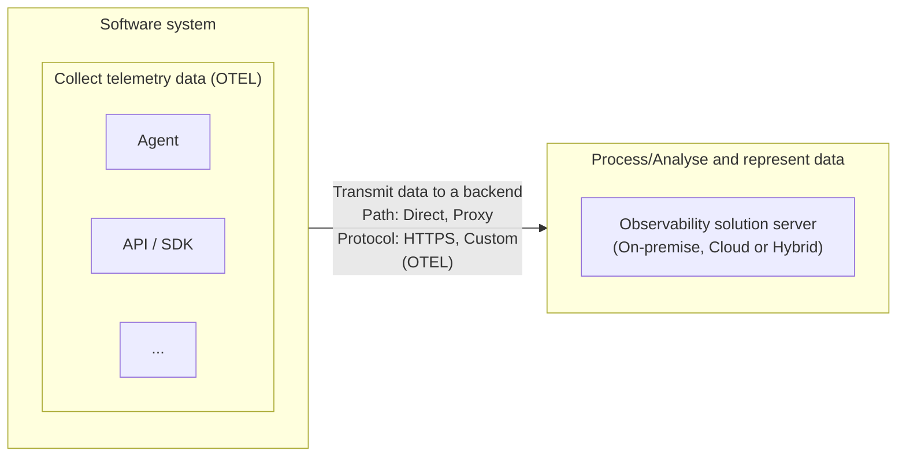
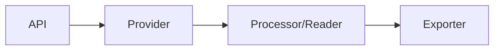
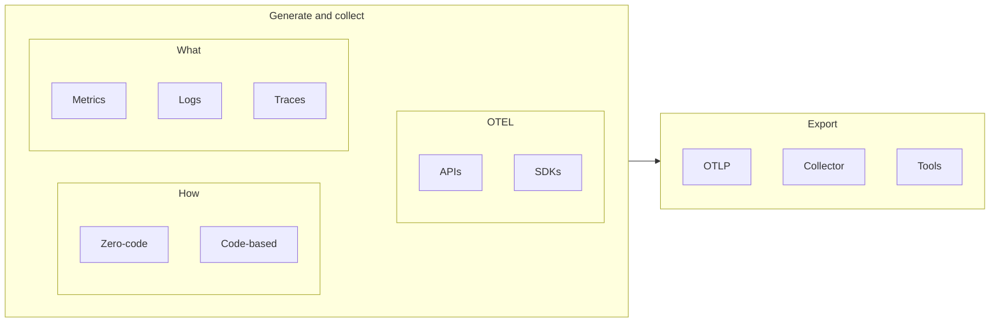

## Observability fundamentals

Observability is the process of understand the internal state of a system using output measurements. It improves these non-functional system requirements:

- Availability
- Reliability
- Performance

These three together gives us the software system **stability**.

### Monitoring versus observability

Different from monitoring, observability helps identify underlying cause of a failure or incident.

### Telemetry signals

- **Metrics**: numerical values as point in time
- **Logs**: records of activities or events (events are a specific type of log)
- **Traces**: shows the path and request states through a system
- **Baggage**: is a key-value information that can be propagated alongside context element
- **Profiles**: is a collection of samples and associated metadata that shows where applications consume resources during execution

### Reliability metrics

All metrics below are improved by an observability system, but the monitoring system only improves the **MTTD**.

- Mean time to detect (MTTD) - improved by monitoring and observability.
- Mean time to repair (MTTR)
- Mean time between failures (MTBF)
- Mean time to failure (MTTF)

### General structure of observability solutions

## Instrumentation process

- **Zero-code**: adds API & SDK capabilities as agent or agent-like installation
  - _OpenTelemetry eBPF Instrumentation_: instrumentation on kernel level (only for linux)
- **Code-based**: manual instrumentation
- **Libraries**: between zero-code and code-based

## Code-based instrumentation

### 1. Metrics

1. Initialize a meter provider on top of application
2. Meter creates metric instruments which captures measurements
3. Metric exporter sends metrics to a consumer

Every metric instrument is defined by 4 fields:

- Name
- Kind
  - Counter
  - Asynchronous counter
  - UpDownCounter
  - Asynchronous UpDownCounter
  - Gauge
  - Histogram
- Unit (optional)
- Description (optional)

### 2. Traces

1. Initialize a tracer provider on top of application
2. Create a Tracer component
3. The Tracer generates spans
4. Trace exporter sends spans to a consumer

Every span has some properties:

- Name
- Span context
  - Trace ID
  - Span ID
  - Trace flags (sampled?)
  - Trace state (custom vendor data)
- Parent span ID
- Start and end timestamps
- Attributes
  - Key-value pair with custom information
- Span events
  - Structured log message
- Span links
- Span status
  - unset (default - success)
  - error
  - ok (user defined success)
- Span kind
  - client
  - server
  - internal
  - producer
  - consumer

> [!info]
> **Context propagation** is what keeps multiples spans together.

Default propagator (W3C trace context):

- `traceparent`
- `tracestate`

### 3. Logs

- OpenTelemetry supports existing legacy of logs and logging libraries + enhance
- Does not provide bespoke API or SDK to create logs
- Enhances existing logs with correlation data (trace id, span id etc.)
- Provides capabilities to receive, process and export log data to a consumer/backend server

Every log object has some properties:

- Timestamp
- ObservedTimestamp
- TraceId
- SpanId
- TraceFlags
- SeverityText (log level)
- SeverityNumber
- Body
- Resource
- InstrumentationScope
- Attributes

### 4. Baggage

- A key-value store
- Usually used to pass contextual information between different services, for example a `user_id`
- Also can be passed between signals

### 5. Profilling

- Snapshots of code resource utilizations (CPU / Memory)
- Application-level profiling
- System-level profiling
- It has available the opentelemetry-ebpf-profiler

## SDK Architecture and composability

The SDK it's the engine that provides the `resource` and `exporters` elements.

It has three main elements:

- Meter Provider
- Tracer Provider
- Logger Provider

Each module has your own plugins interfaces and the high level used mental model follows the paradigm:

There are three ways to configure the SDK:

- Programmatic configuration
- Environment variables
- Configuration files

## OpenTelemetry's anatomy

## Standards

- **Open Telemetry Protocol (OTLP)**: it's a general purpose protocol that ensures that data can be efficiently transmitted from applications to observability backends reliably. It defines how telemetry data is encoded, transported and delivered.
- **Semantic Conventions**: is a shared dictionary with a defined standardized telemetry naming and structure. Make it consistent, portable and tool-friendly. Required for SDKs and instrumentation authors, also recommended for developers.

The first moves your data and the second one describes it.

## Collector

It's an intermediate component between the data sources and the observability backend. It provides some capabilities such as: batch, enrich, filter or even sampling data.

Principal components are:

- Receiver
- Processor
- Exporter
- Extensions
- Service and pipelines

- Deployment patterns: agent, gateway and mixed.
- Scaling strategies: vertical and horizontal scaling.

The collector is an optional element but extremely recommended.

## Debugging and maintenance observability pipelines

### 1. Troubleshooting context propagation

- Mismatched propagators - W3C TraceContext and B3
- Headers stripped - Load balancer, API Gateway, Reverse Proxy etc.
- Failed context injection

### 2. Debugging collector pipelines

- Debug exporter
- Collector validate subcommand
- Internal telemetry
- zPages

### 3. Error handling and data loss

- Exporter retries
- Queues - in memory and persistent
- Set up the `memorylimiterprocessor`
- Backpressure

### 4. Schema management

It's possible to use an schema translate processor to translate one schema version into another. This problem appears when there are multiple semantic conventions being used on the application.

## Site reliability engineering (SRE) principles

| Term         | Definition                              | Key Concept            |
| ------------ | --------------------------------------- | ---------------------- |
| SLIs         | Service level indicator                 | Measures               |
| SLOs         | Service level objective                 | Target                 |
| SLAs         | Service level agreement                 | Commit                 |
| Error budget | Space between target and perfect states | Room for make mistakes |

Commonly used metrics:

- Availability SLO
- Latency SLO
- Error SLO

> [!example]
> Error rate:
>
> - Error rate SLI = (Failed request / Total of valid requests) * 100
> - Error rate SLO: the error rate must remain below 1% over a 28-day window.

SRE practices recommend a window of at least 28 days (4 weeks).
